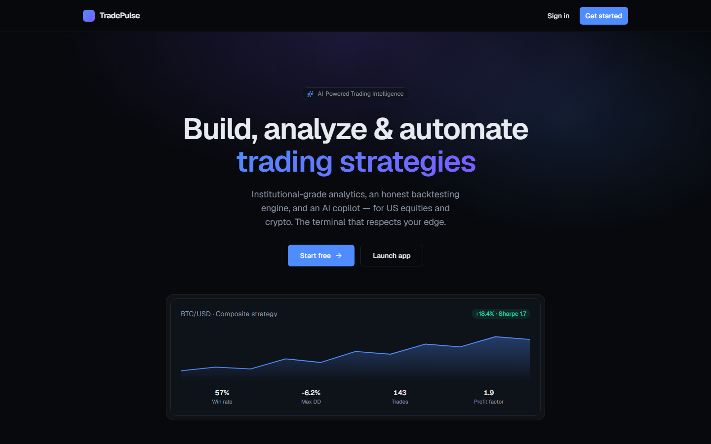

<div align="center">

# 📈 TradePulse

### A local-first quantitative research workbench — US equities + crypto.

Turn a plain-English strategy idea into a validated spec, simulate it on historical bars with a
**look-ahead-free event-driven engine**, and run it against a **paper (simulated) ledger** on
delayed market data.

**The AI proposes and explains; deterministic code validates, calculates, simulates, and enforces
the risk boundaries.** Real-money order placement is not implemented — the live-trading seam
refuses by construction.

[](#methodology--honest-limits)


<br/>



</div>

---

## What this is (and is not)

TradePulse is a research and education tool for **US equities + crypto**:

- a **natural-language → strategy-spec compiler** whose output must pass validation before it runs;
- a **reproducible backtesting platform** (spec hash + engine version + data fingerprint per run);
- a **paper-trading simulator** on delayed, polled bars;
- charting and indicators computed by the same code the engine uses.

It is **not** a signal service, **not** an autonomous trading bot, **not** a source of financial
advice, and **not** connected to any brokerage for live orders. Backtest and paper output is a
*historical simulation under the displayed assumptions* — hypothetical, and not predictive of
future performance.

## Stack
- **Backend:** Python 3.12, FastAPI, Pydantic v2, SQLAlchemy 2.0 (async), Alembic, ARQ
- **Data:** PostgreSQL + TimescaleDB, Redis
- **Market data (free):** CCXT (crypto OHLCV) + yfinance (equities) out of the box; Alpaca optional (free paper keys)
- **Frontend:** Next.js 16 (App Router) + TypeScript + Tailwind v4 + hand-rolled CVA primitives
  (`components/ui/*`), TanStack Query, lightweight-charts. No component library, no client store.
- **AI (free):** Google Gemini (free tier) by default, or a local Ollama model — both no-cost
- **Tooling:** `uv` (Python), `npm` (web), `just` (tasks), Docker Compose, Caddy (prod)

## Quick start
```bash
cp .env.example .env          # then fill secrets (see comments in the file)
just bootstrap                # uv sync + docker up + migrate
just seed                     # register the equity + crypto instrument universe
just backfill BTC/USD 2       # pull 2 days of REAL 1m bars (free, via CCXT) — repeat per symbol
just api                      # FastAPI at http://localhost:8080  (/docs, /health)
just worker                   # ARQ worker: market-data ingestion + paper-trading cron
just web                      # Next.js at http://localhost:3000
```

Frontend environment contract: [`apps/web/.env.example`](apps/web/.env.example). Note that every
`NEXT_PUBLIC_*` value is **inlined at build time** — in Docker they must be passed as build args
(`infra/Dockerfile.web`), not as runtime container environment, or the shipped bundle silently
carries the fallbacks instead.

## Layout
```
apps/
  api/                  FastAPI app + ARQ worker (modular monolith)
    app/
      core/             kernel: config, db, redis, security, errors, events, observability
      modules/
        auth/           users, sessions, credentials, broker_connections (encrypted)
        indicators/     closed indicator catalog + causal computation (charts, engine, features)
        market_data/    instruments, OHLCV store, providers, WS fan-out of polled bars
        strategies/     canonical StrategySpec DSL, CRUD, versioning
        backtesting/    event-driven engine, metrics, cost models
        robustness/     walk-forward, sweeps, cost stress, Monte Carlo, multiple-testing correction
        experiments/    append-only record of every analysis, with full provenance
        research/       composed surfaces: signal eval, reference backtest, public per-ticker API
        trading/        paper engine, portfolio, brokers + gated live seam
        ai/             model providers (Gemini/Ollama), NL->spec compiler, evaluation
        audit/          append-only event log
      cli/              seed, backfill, export_openapi
    alembic/            migrations (single linear head)
    tests/              unit + integration + financial-correctness
  web/                  Next.js frontend (app router, generated typed API client)
packages/contracts/     OpenAPI spec -> generated TS client + zod
infra/                  Dockerfiles, compose.prod.yaml, Caddyfile, deploy/backup scripts, observability
docs/                   DEPLOY runbook + Architecture Decision Records (docs/adr/)
```

## Guiding invariants
1. Every domain row is `owner_id`-scoped. This is a **tenancy seam**, not a finished SaaS: there is
   no billing, no organizations, and no RBAC (see `docs/adr/0005-owner-id-tenancy.md`).
2. Money is `Decimal`/`NUMERIC` server-side and crosses the API as decimal **strings**; the browser
   formats those strings and never does arithmetic on them.
3. One bar lifecycle (`forming → is_final`); decisions only ever act on closed bars.

## Methodology & honest limits
Credibility comes from transparency, not cherry-picked numbers. What is genuinely real today:
- **Simulations are look-ahead-free** — event-driven bar replay; orders fill at the *next* bar's open,
  never the signal bar's close. Every run is reproducible (spec hash + engine version + data fingerprint).
- **Costs modeled by default** — commission 2 bps/side + 1 bps slippage on every fill; the API exposes
  no way to disable them. Reported figures are net, and total commission is shown alongside each result.
- **Risk controls are enforced** — position caps, max-daily-loss halt, consecutive-loss limits; each
  risk event is recorded on the result.
- **Reporting conventions are stated** — drawdown always shown next to returns; Sharpe/Sortino annualized
  with a risk-free rate of 0 (stated wherever they appear); every backtest/paper result carries a
  hypothetical-performance notice.
- **Data provenance** — prices are polled (~30s on the default deployment; less often on the free-tier
  cron path) and labeled `DELAYED` with a fetch time. No real-time or SIP claim, anywhere.
- **The AI copilot is bounded** — it drafts a validated spec, never auto-executes, and is instructed to
  use only the numbers present in a result and to refuse rather than invent. The closing
  not-investment-advice note is a prompt instruction, not a server-side guarantee.

**Deliberately *not* claimed (roadmap, not faked in the UI):** a real-time consolidated (SIP) feed;
real-money order placement (the live gate returns 403 — the controls it would need are unbuilt); a
survivorship-free reference universe (the public track record covers a small, hand-picked list of
currently-listed symbols); survivorship-free / point-in-time fundamentals; a drag-and-drop strategy
builder (strategies are one canonical JSON spec); an automatic in-sample/out-of-sample split;
Deflated-Sharpe / multiple-testing correction; a buy-and-hold benchmark overlay. The in-app
**Methodology** page carries the same list.

## Security & ops
- `/metrics` is gated by `METRICS_TOKEN` (404 without it); request bodies capped at `MAX_REQUEST_BYTES`;
  market-data provider calls bounded by `MARKET_DATA_TIMEOUT_SECONDS`.
- DSN-gated **Sentry** on the API (`SENTRY_DSN`) and web (`NEXT_PUBLIC_SENTRY_DSN`); CSP + React error
  boundaries on the frontend.
- CI adds informational `pip-audit` / `npm audit` + a coverage report alongside the existing
  mypy / import-linter / migration / OpenAPI-drift gates. Backups: `infra/backup.sh` (nightly) +
  `infra/restore.sh` (monthly restore-verify). See [docs/](docs/).

## Third-party notices
Charts are drawn with TradingView's **Lightweight Charts™** (Apache-2.0), whose licence requires
attribution: <https://www.tradingview.com/>. TradingView does not endorse or review TradePulse.

## License
Proprietary — © 2026 Mubin Attar. All rights reserved. **This is not open source.** Personal and
commercial use is reserved to the owner; no third-party use, copying, or redistribution without
written permission. See [LICENSE](LICENSE).
