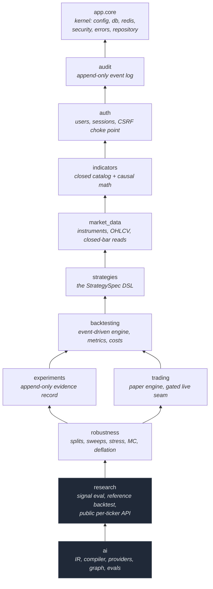
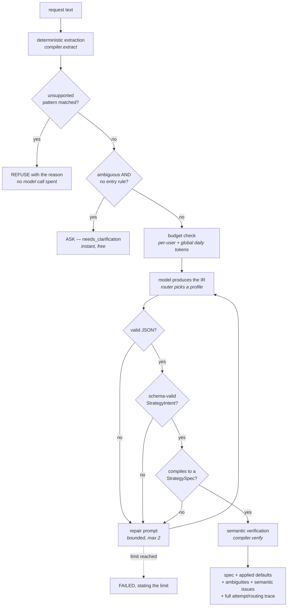
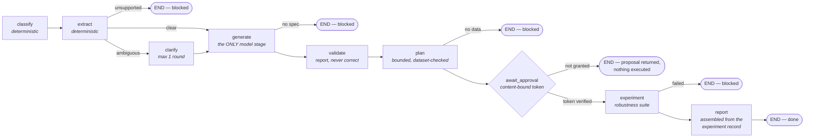

# TradePulse v2 — Target Architecture (as built)

**Status:** describes the system as it exists on `main` at 2026-08-24.
**Scope:** what the code does. Where a docstring, a README line, or an older document
disagrees with the code, the code wins and the disagreement is called out.

This is not a design proposal. Every claim below is anchored to a file and a line. If a
capability is absent it is listed in §14 rather than softened elsewhere — that section is
the one to read first if you are deciding whether to trust a number this platform produced.

---

## 1. Product principle and what it rules out

TradePulse v2 is a local-first, evidence-driven quantitative research workbench: a safe
natural-language-to-strategy compiler, a reproducible event-driven backtesting platform, a
strategy-robustness laboratory, and a paper-trading simulation.

The organising principle is a split of responsibility:

> **The AI proposes and explains. Deterministic systems validate, calculate, simulate and
> enforce risk boundaries.**

That is not a slogan attached to the system; it is the shape of the module graph. The model
participates in exactly one stage of the research pipeline — turning a request into a compact
intermediate representation — and everything before and after it is deterministic code
(`apps/api/app/modules/ai/graph/graph.py:25-27`).

### What the system structurally cannot do

These are properties of the code, not of an instruction in a prompt.

**It cannot execute code, SQL, or a shell.** The agent's entire capability surface is the set
of typed functions in `apps/api/app/modules/ai/graph/tools.py`. There is no `exec`, no raw
query string, no subprocess, no HTTP client and no filesystem access in that module, because
those functions do not exist for it to call (`tools.py:1-16`). Safety is a property of the
available tools.

**It cannot place an order.** No tool in `tools.py` reaches an order, and the live-execution
endpoint refuses by construction: `LiveTradingGate.evaluate` requires seven independent
controls, of which `feature_enabled`, `user_opted_in`, `twofa_enabled`, `recent_step_up` and
`confirmation_valid` are all unbuilt or default-false
(`apps/api/app/modules/trading/live_gate.py:24-38`). Even if every gate passed, the handler
ends in an unconditional `raise PermissionDeniedError("Live execution is not enabled.")`
(`apps/api/app/modules/trading/live_router.py:52-61`). `POST /live/orders` answers 403.

**It cannot act on an unapproved plan.** The research graph halts at `await_approval` and the
proposal pass runs nothing (`graph.py:244-263`, `graph.py:376-392`). Resuming requires an HMAC
token minted over the strategy hash, the dataset fingerprint, the plan hash, the risk-policy
version and the owner id (`apps/api/app/modules/ai/graph/approval.py:42-65`). Change any of
those and the token stops verifying.

**It cannot answer a request it should refuse.** Requests naming real-money execution,
guarantees, insider information, leverage, options, shorting or multi-instrument portfolios are
matched against explicit patterns and refused *before* a model call is spent
(`apps/api/app/modules/ai/compiler.py:78-116`, `apps/api/app/modules/ai/service.py:167-183`).

**It cannot silently ignore a capability it lacks.** A `StrategySpec` that asks for something
engine 0.1.0 cannot execute is rejected at validation, not accepted and quietly dropped
(`apps/api/app/modules/strategies/spec.py:206-245`). See §4.

**It cannot narrate numbers it was not given.** `/ai/explain` assembles the evidence payload
server-side from a persisted experiment the caller owns (`apps/api/app/modules/ai/router.py:92-118`),
and every number in the generated text is matched arithmetically against that payload
(`apps/api/app/modules/ai/grounding.py:124-158`).

What it is **not**: a signal seller, financial advice, or an autonomous trading bot.

---

## 2. Module DAG

### The contract

`pyproject.toml:110-140` declares two import-linter contracts, and CI runs `lint-imports` as a
hard gate (`.github/workflows/ci.yml:48-49`). The layer list, verbatim from
`pyproject.toml:116-128` (highest first — a module may import only from layers strictly below
it):

```
app.modules.ai
app.modules.research
app.modules.robustness
app.modules.experiments | app.modules.trading
app.modules.backtesting
app.modules.strategies
app.modules.market_data
app.modules.indicators
app.modules.auth
app.modules.audit
app.core
```

The second contract forbids `app.core` from importing any `app.modules.*`
(`pyproject.toml:136-140`).

**`ignore_imports` is absent.** There are zero sanctioned violations. Running the linter today:

```
Analyzed 135 files, 398 dependencies.
Layered architecture (...) KEPT
Kernel is independent of domain modules KEPT
Contracts: 2 kept, 0 broken.
```

This matters because the contract was *broken at HEAD* before v2 — six unsanctioned upward
edges from `market_data` into `backtesting`/`strategies`, with a stale comment claiming
`reference_backtest`/`public_router` were "the one allowed upward edge" and an `ignore_imports`
list waiving five of them (`docs/v2/CURRENT_STATE_AUDIT.md:278-317`,
`docs/v2/BASELINE_VERIFICATION.md:198-215`, ranked `ARCH-01`, the #1 issue in the audit).



*(Edges show the layer ordering, not every concrete import. A module may import from any layer
below it, not only the adjacent one.)*

### What each layer owns, and why it sits where it does

**`app.core` (L0, kernel).** Config, the async SQLAlchemy engine and session, Redis, structured
logging, error types and handlers, middleware, the security primitives (argon2, cookies, CSRF,
body-size limit, metrics guard), and `OwnedRepository`. It is forbidden from importing any
domain module (`pyproject.toml:136-140`) so that the tenancy primitive, the session lifecycle
and the error taxonomy stay reusable and testable without dragging a domain in. `OwnedRepository`
lives here and knows nothing about `User` — the dependency that resolves a user lives in `auth`
instead (`apps/api/app/modules/auth/deps.py:1-5`).

**`audit` (L1).** An append-only table of security- and trade-relevant events. It sits directly
above the kernel and below `auth` because `auth` writes to it on register, login, logout,
password change, account delete and password reset (`apps/api/app/modules/auth/router.py:71,106,130,167,199,249`)
and nothing writes to `auth` from below. Hash-chaining and a verifier are explicitly deferred
to a real-money phase (`apps/api/app/modules/audit/__init__.py`).

**`auth` (L2).** Users, credentials, Redis-backed sessions, the `get_current_user` dependency
(which is also the single CSRF choke point — §12), the `get_owned` factory, and encrypted broker
connections. Everything above it that serves an authenticated route depends on it; it depends on
nothing above.

**`indicators` (L3) — moved DOWN.** The closed indicator catalog (`catalog.py`) and its causal
computation (`compute.py`). This is the first of the two structural fixes. In v1 the indicator
math lived inside `backtesting.compute`, which meant the chart API and the point-in-time signal
evaluator — both of which need *identical* numbers — had to reach upward into the backtesting
layer to get them. That is what broke the contract. **An indicator is a primitive, not a
backtesting concern**: the chart endpoint, the strategy DSL's operand validator, the engine, the
robustness lab and the public reference backtest all read the same values, so the math is owned
at a layer all of them can see (`apps/api/app/modules/indicators/__init__.py:1-8`). To stay
below `market_data`, `compute.Bar` is a *structural* `Protocol` rather than an import of
`market_data.BarPoint` (`apps/api/app/modules/indicators/compute.py:29-49`).
`backtesting/compute.py` is now a thin re-export plus the one genuinely
backtesting-specific piece: evaluating a `Condition` tree at a single closed bar index
(`apps/api/app/modules/backtesting/compute.py:1-29`).

**`market_data` (L4).** Instruments, vendor symbol mappings, the 1-minute OHLCV store, provider
adapters (CCXT / yfinance / Alpaca), ingestion, WebSocket fan-out, and the closed-bar read
contract (§3). It sits above `indicators` because the chart endpoint composes bars with
indicator series (`apps/api/app/modules/market_data/router.py:88-149`); it sits below
`strategies` because a bar has no idea what a strategy is.

**`strategies` (L5).** The canonical `StrategySpec` DSL (ADR-0008), CRUD, and immutable
append-only versioning. It imports the indicator catalog to validate operand references
(`spec.py:18-25`) and nothing else from the domain. The DSL is deliberately below the engine so
that the DSL — not the engine — is the single place a capability boundary is declared.

**`backtesting` (L6).** The event-driven engine, the metrics module, the cost model types, result
serialization, the per-run service and orchestration, and the persisted `Backtest` row. It
consumes bars and specs; nothing below it knows it exists.

**`experiments | trading` (L7, siblings, mutually independent).** `|` is import-linter's
*independent* delimiter: neither may import the other. `experiments` owns the append-only
evidence record and its owner-scoped repository. `trading` owns paper trading (which re-runs the
same engine with `close_at_end=False`), the position-size calculator (a thin wrapper over the
engine's own `_size`, `apps/api/app/modules/trading/calc.py:1-21`), the alert feed, broker
connections and the live gate. They are siblings because a paper session is not evidence and an
experiment is not a trade; coupling them would let one drag the other's persistence into scope.

**`robustness` (L8).** The five attacks, the bounded override language, and the stability
checklist. It sits above `experiments` because `RobustnessService` persists an `Experiment` per
suite (`apps/api/app/modules/robustness/service.py:97-131`), and above `backtesting` because
every analysis re-runs the *actual* engine rather than approximating from a stored curve
(`apps/api/app/modules/robustness/lab.py:7-11`).

**`research` (L9) — moved UP.** The second structural fix. `research` owns the *composition
surfaces*: point-in-time signal evaluation (`signal.py`), the canonical public reference
backtest (`reference_backtest.py`), and the unauthenticated per-ticker API
(`public_router.py`). Each of these needs the engine, the metrics and the DSL. In v1 they lived
in `market_data`, three layers too low, and the imports pointed the wrong way. They are
composition, not persistence — they own no tables — so the honest home is a layer *above*
backtesting (`apps/api/app/modules/research/__init__.py:1-9`). The URL shape was deliberately
preserved through the move (`apps/api/app/modules/research/router.py:6-8`): this was a layering
change, not an API change, and the OpenAPI drift guard proves it.

**`ai` (L10, edge).** IR, deterministic compiler, provider abstraction, prompt registry,
circuit breaker, budgets, grounding, the LangGraph research graph, and the evaluation harness.
Nothing depends on it, so it can fail or degrade without taking the platform down
(`apps/api/app/modules/ai/__init__.py:1-2`). `evaluations` is not named as a layer; it lives
under `app.modules.evaluations` and imports only from `ai` and below.

---

## 3. The bar lifecycle and the closed-bar contract

### Storage

One row is one fully-closed 1-minute bar, timestamped at the bar's **open**, half-open
`[ts, ts+1m)` (`apps/api/app/modules/market_data/models.py:62-78`). Higher timeframes are never
stored; they are derived on read. `is_final` is the lifecycle flag: a forming bar may be
overwritten, but once final it is immutable — the upsert carries
`where=OHLCV.is_final.is_(False)` so a re-ingest of a final bar is a no-op
(`repository.py:122-134`). Writes are chunked at 2,000 rows to stay under asyncpg's 32,767-
parameter ceiling, in the repository rather than at the call site
(`repository.py:29-31,114-119`).

### Derived timeframes

`get_bars` reads raw for `1m` and otherwise aggregates on the fly with portable Postgres —
`date_bin` for bucketing and ordered `array_agg` for first-open/last-close, so it runs
identically on plain Postgres and TimescaleDB (`repository.py:216-266`). Buckets are anchored to
the Unix epoch in UTC (`repository.py:48-50`) so a bucket's identity never depends on the DB
session timezone or the query window.

### The closed-bar contract

A derived bar is returned **only once its whole interval has elapsed AND it was built from every
bar it has**. Two independent ways a bucket could be incomplete, both excluded:

**Still forming.** At 09:18 UTC the 09:00 hourly bucket holds 18 of its 60 minutes. The `HAVING`
clause drops any bucket whose end is after `min(end, now)`:

```sql
HAVING date_bin(INTERVAL '1 hour', min(ts), TIMESTAMPTZ '1970-01-01 00:00:00+00')
       + INTERVAL '1 hour' <= :cutoff
```

(`repository.py:245-246`, with `cutoff = min(end, now or datetime.now(UTC))` at
`repository.py:232`.) Without it, the engine, the signal card and the public reference backtest
would all act on an unfinished bar — the audit found exactly that at every timeframe above 1m
(`docs/v2/CURRENT_STATE_AUDIT.md`, `MD-01`, ranked #13).

**Clipped by the window.** A window starting at 03:47 would build the 03:00 bucket from only its
last 13 minutes and report a wrong open/high/low. The scan is therefore widened to
`floor_to_bucket(start, timeframe)` (`repository.py:67-76,251-258`), so a bucket is either built
from all the bars it has or not returned at all.

### `bar_count`

Every returned `BarPoint` carries `bar_count`: how many 1-minute bars actually backed it —
`1` for a raw 1m read, the aggregate `count(*)` for a derived one
(`repository.py:53-64,241,263`). This exposes **venue gaps** without a second query. A 1h crypto
bucket should hold 60; a US-equity hourly bucket spanning a half-day close will not. The research
graph's dataset inspector uses it to count `incomplete_buckets` and put that number in the plan,
so a plan cannot overstate its coverage (`apps/api/app/modules/ai/graph/tools.py:109,118-121,175`).

### Point-in-time replay

`bars_as_of` is a stricter read for replay scenarios: only bars fully closed by `as_of`, i.e.
`ts <= as_of - 1m` (`repository.py:139-164`). It is tested (`apps/api/tests/test_market_data.py:80-107`)
but is not currently called by any product surface — see §14.

---

## 4. The StrategySpec DSL

`apps/api/app/modules/strategies/spec.py` is the single contract shared by the builder UI, the
backtest engine, paper trading, the robustness lab and the AI layer (ADR-0008).

**Declarative and non-Turing-complete.** There are no loops, no variables, no user-supplied
expressions. A rule is a tree of `Comparison` and `Group` nodes (`spec.py:78-96`); an operand is
one of `price`, `indicator` or `const`, each with an optional linear transform
(`multiplier * X + offset`, `spec.py:57-75`). Every model sets `extra="forbid"`, so an unknown
field is a validation error rather than a silently dropped one.

**Closed indicator catalog.** Operands may reference only the eight catalog entries — EMA, SMA,
RSI, ATR, BBANDS, MACD, VWAP, VOL_SMA — each with typed parameters and inclusive ranges
(`apps/api/app/modules/indicators/catalog.py:20-49`). Nothing is exposed merely because pandas
can compute it: a catalog entry is a commitment to test it, document its warm-up, and keep its
alignment causal (`catalog.py:1-12`). Cross-field validation checks that every operand's `ref`
resolves to a declared indicator and that a multi-output indicator's `output` selector is one of
its declared outputs (`spec.py:166-204`).

**Warm-up is a contract, not an implementation detail.** `warmup_bars()` returns the number of
leading bars that legitimately yield NaN, and the numbers are asserted against the
implementation in `apps/api/tests/quant/test_indicators.py` so the two cannot drift silently
(`catalog.py:86-111`). RSI's warm-up is one bar longer than an SMA's because Wilder seeds from
the mean of the first `period` *deltas* and a delta needs a prior bar (`catalog.py:100-103`).

**Exits, sizing and risk are mandatory.** `ExitRule` requires at least one of stop-loss,
take-profit, trailing stop, time exit or an exit condition tree (`spec.py:107-118`).
`PositionSizing` and `RiskLimits` are non-optional fields of `StrategySpec` (`spec.py:162-163`).
This makes the legacy's optimistic, entry-only strategy **un-authorable**.

**Identity.** `canonical_json()` is sorted-key, separator-normalised JSON, and `spec_hash()` is
its SHA-256 (`spec.py:247-251`). That hash is what a strategy version, an experiment, and an
approval token are all bound to.

### The capability boundary rejects rather than ignores

`_reject_unsupported()` (`spec.py:206-245`) is deliberately the **only** place a capability
boundary is declared. It refuses:

| Rejected | Why | Line |
|---|---|---|
| `entry_short` present | engine 0.1.0 is long-only; a long/short strategy would backtest as long-only and report a P&L missing an entire leg | `spec.py:225-229` |
| `universe` with more than one symbol | only `universe[0]` was ever run | `spec.py:230-235` |
| `risk.max_open_positions != 1` | the engine holds a single position by construction, so the limit did nothing | `spec.py:236-240` |
| `sizing.method == "risk_per_trade"` without `exit.stop_loss_pct` | sizing silently degraded to percent-of-equity — a completely different risk profile | `spec.py:241-245` |

Every one of these was previously *accepted, validated, described to the AI copilot, and then
silently dropped*. Accepting a field and quietly ignoring it is the worst failure mode a research
tool can have, because the run still produces a confident-looking equity curve
(`spec.py:207-224`). When a capability lands, the corresponding check is removed — and that
removal is the capability's declaration.

Because the AI's compiler is the only thing that writes a `StrategySpec`
(`apps/api/app/modules/ai/ir.py:25-27`), and because a swept parameter is re-validated through
the same model (`apps/api/app/modules/robustness/overrides.py:90-119`), these rules apply
identically to hand-authored, model-generated and machine-swept specs.

---

## 5. The execution model

`apps/api/app/modules/backtesting/engine.py:115-366`. Long-only, one position, one instrument.

### The per-bar event order, exactly as implemented

`for i, bar in enumerate(bars)` (`engine.py:221`):

1. **Pending exit fills at this bar's open** (`engine.py:230-233`). A `signal` or `time` exit
   decided at bar `i-1`'s close is booked at `sell_fill(open)`.
2. **Pending entry fills at this bar's open** (`engine.py:235-273`). Size is computed from
   `equity = cash`, the slipped fill, the spec's stop percentage, and the ATR value **at bar
   `i-1`** — the decision bar, never the bar being filled on (`engine.py:239-246`). It is then
   clamped by `max_position_pct` (emitting a `position_clamped` risk event) and again by
   available cash including commission (`engine.py:247-258`). Trail state is armed from the
   **entry price**, not this bar's high (`engine.py:268-271`).
3. **Intrabar bracket checks** (`engine.py:275-300`). The stop level live *at the open* is
   captured **before** the trail ratchets on this bar's high (`engine.py:283-289`), then the
   stop and target are tested.
4. **Time exit is armed for the next open** (`engine.py:302-304`).
5. **Mark-to-market at the close** — one `EquityPoint` per bar (`engine.py:306-308`).
6. **Daily-loss kill-switch** evaluated against the equity just recorded (`engine.py:310-318`).
7. **Decisions at the close for the NEXT bar** (`engine.py:320-336`). Entry conditions are
   evaluated only when flat, not halted by the consecutive-loss kill switch, not day-halted, and
   inside the `time_of_day` window; exit conditions only when in a position. `i < len(bars) - 1`
   means the final bar never arms an order that could not fill.

At the end, a backtest flattens (`close_at_end=True`) and overwrites the last equity point with
realised cash; paper trading (`close_at_end=False`) keeps the position and reports it as
`open_position` (`engine.py:338-351`).

### Fill rules

- **Market orders fill at the next bar's open.** A decision is made at the close of bar `i` and
  can only fill at bar `i+1`'s open. There is no path that reads the signal bar's close as a
  fill price.
- **Long entry:** `open * (1 + slip)` (`engine.py:79-85`). **Exit:** `price * (1 - slip)`
  (`engine.py:177-178`). Slippage is always adverse.
- **Stop and target fill AT THE LEVEL unless the bar gapped through it.** A genuine gap-through
  is defined as the market opening at or below the level that was *already live* —
  `gapped = stop_at_open is not None and o <= stop_at_open` (`engine.py:291-297`); the target's
  symmetric test is `o >= target_price` (`engine.py:298-300`). Capturing `stop_at_open` before
  the ratchet is load-bearing: after a ratchet the open is mechanically below the new trail, so
  every trailing exit on a rallying bar was previously misclassified as a gap and booked at the
  open — on a 102 → high 130 → low 101 bar with a 10% trail that reported an exit at 102 when
  the trail that actually fired was 117 (`engine.py:276-282`; audit `BT-01`, ranked #10).
- **Trailing stops arm from the entry price.** `highest = fill` (`engine.py:268-271`), not the
  fill bar's high, which may have printed before the fill and would ratchet the trail off a level
  that was never tradable.
- **The stop check precedes the target check** on the same bar (`elif` at `engine.py:298`) — a
  bar that touches both is resolved conservatively.

### Cost model

`ExecutionConfig` (`apps/api/app/modules/backtesting/types.py:14-37`) carries
`commission_bps=2.0` per side, `slippage_bps=1.0` adverse, `initial_cash=Decimal("100000")` and
a `frictionless` flag that is **test-only** and loudly labelled. `COST_MODEL_VERSION = "1.0.0"`
(`types.py:11`) and `as_dict()` writes the whole assumption set into every persisted result
(`types.py:29-37`, consumed at `apps/api/app/modules/backtesting/snapshot.py:49`). Before this,
a frictionless run and a costed run serialised identically, so a stored result could not be told
apart from one produced with zero costs.

Commission is charged on the notional of **both legs**, and `Trade.commission` records the
round trip — the entry leg is recovered exactly as `entry_gross - (qty * entry_price)`
(`engine.py:188-193`). Recording only the exit leg made `Trade.commission` silently half the
true cost for anything summing it.

### Decimal versus float

The boundary is explicit and one-directional.

- **Decimal** — cash, quantity, prices, notional, commission, P&L, equity. Every field of
  `Trade`, `EquityPoint` and `BacktestResult` that represents money or quantity is `Decimal`
  (`types.py:40-83`), stored as `NUMERIC` (`market_data/models.py:28-30`), and serialised as a
  **string** (`snapshot.py:40-75`). ADR-0006.
- **float** — indicator values, comparisons, and analytics. Indicator math runs in numpy/pandas
  for speed (`indicators/compute.py:9-12`), and metrics convert equity to float because they are
  display/analytics numbers (`metrics.py:27-28`).

The two never mix: an indicator value is only ever compared against another indicator, a price,
or a constant — never added to cash. The single crossing point is `Decimal(str(atr_value))` when
ATR-based sizing turns a float risk unit into a Decimal stop distance (`engine.py:65-70`), and
`float(...)` on prices when building the indicator frame (`indicators/compute.py:59-68`).

---

## 6. Metrics discipline

`apps/api/app/modules/backtesting/metrics.py`. `METRICS_VERSION = "2.0.0"` (`metrics.py:40`),
stamped onto every serialized result (`snapshot.py:47`) and every experiment
(`robustness/service.py:112`).

**Calendar-aware annualization.** `periods_per_year(timeframe, calendar)` derives bars per year
from the instrument's trading calendar: XNYS is 252 sessions of 390 regular-session minutes,
24x7 is 365 days of 1,440 (`metrics.py:44-70`). Annualizing an hourly Sharpe at 8,760 periods is
right for BTC and roughly 5x too large for AAPL. The calendar reaches the engine from
`Instrument.calendar` (`backtesting/service.py:58`, `market_data/models.py:44`) and defaulting
it to 24x7 for an equity would inflate an hourly Sharpe by about 2.3x (`engine.py:125-130`).

**CAGR does not use `periods_per_year` at all.** It uses wall-clock elapsed time from the equity
curve's own timestamps (`metrics.py:132-133,168-175`), which handles holidays and weekends
exactly rather than approximately.

**Sample-size floors, stated in the response.** Anything that annualizes or extrapolates returns
`None` below a documented floor (`metrics.py:52-54`):

- `MIN_RETURNS_FOR_RATIO = 30` and `MIN_TRADES_FOR_RATIO = 5` gate Sharpe and Sortino
  (`metrics.py:157-166`);
- `MIN_DAYS_FOR_ANNUALIZED = 180.0` gates CAGR and Calmar (`metrics.py:168-178`).

Purely descriptive statistics — total return, max drawdown, longest underwater run, win rate,
trade counts, exposure, turnover — are **always** reported: they are facts about the run, not
claims about the future (`metrics.py:137-154,180-203`). `sample_size_notes()` turns each
suppression into a human-readable reason so the UI can render "n/a" *with the reason* rather than
hiding the row (`metrics.py:208-231`). The baseline audit found a 6-bar run reporting
`sortino: -54045` in the authed UI (`BT-04`/`BT-05`, ranked #11).

**Undefined is not zero.**

- Profit factor with no losing trade is `None`, not the gross dollar winnings — the previous
  branch printed $1,200 of profit as a ratio of `1200.0` (`metrics.py:186-188`).
- Sharpe with zero return variance is `None` (`metrics.py:161-163`).
- Sortino uses the standard downside deviation: RMS of shortfall below the target over **all**
  observations, not the standard deviation of the negative returns about their own mean — the
  latter measures how *varied* the losses were, so a strategy losing a steady 0.5% a day scored a
  near-infinite Sortino (`metrics.py:73-84`).
- `recovery_bars` is `None` when the deepest trough never recovered (`metrics.py:150-154`).

`BacktestResult.metrics` is typed `dict[str, float | None]` so the absence is carried all the way
to the API rather than coerced at a boundary (`types.py:75-77`).

---

## 7. The robustness lab

`apps/api/app/modules/robustness/`. A single backtest is one draw from a distribution, on one
sample, with one parameter set and one cost assumption. This module turns one result into an
argument by attacking it from five independent directions
(`apps/api/app/modules/robustness/__init__.py:1-24`).

Every analysis is a pure function of `(spec, bars, config)` — no database, no network — and every
one **re-runs the actual engine** rather than approximating from a stored equity curve. Re-running
is slower, but an approximation cannot show the thing that matters most: that under higher costs
a strategy stops taking some trades entirely (`lab.py:1-11`).

### The five attacks

**1. Splits — did it work out of sample?** `walk_forward` produces rolling folds where the
evaluation window is strictly later than everything before it, `anchored=True` growing from a
fixed origin and `anchored=False` sliding a fixed window (`splits.py:96-158`). Each fold reports
in-sample **and** out-of-sample headline metrics side by side, because the *gap* is the finding —
40% in sample and -2% out of sample has not "made 40%" (`lab.py:81-150`). A split that cannot be
honoured raises `SplitError` rather than quietly returning fewer folds (`splits.py:64-70,149-157`);
the service catches it and records it as `walk_forward_error`, an explicit gap in the evidence
(`service.py:193-208,242`). Note the honest caveat carried in the report: this engine has no
fitted parameters, so "in sample" means the earlier window rather than a training set
(`lab.py:98-100`).

`purged_kfold` implements Lopez de Prado purging (dropping training rows whose label window
overlaps the test window) and embargoing (dropping a gap after each test window) on bar indices
(`splits.py:161-199`). It is for supervised datasets and is not currently wired into any product
surface — see §14.

**2. Sensitivity — plateau or spike?** `run_sensitivity` runs the whole bounded grid and reports
the *shape* of the surface, never the maximum alone (`lab.py:206-286`). `positive_share`,
`median_return` and a `neighbourhood_note` answer whether good results form a plateau (the
parameter does not have to be exactly right, so the effect is probably real) or a spike (only one
cell works, so it is almost certainly a curve fit). Cells that fail spec validation are dropped
but **counted** and reported, so the sweep's real size is never overstated (`lab.py:225-234,281-285`).

**3. Cost stress — how thin is the edge?** `run_cost_stress` re-runs the engine at
`(1.0, 1.5, 2.0, 3.0, 5.0)x` commission and slippage and reports `breakeven_multiple`: the
smallest tested multiple at which the strategy stops being profitable (`lab.py:312-378`). If that
number is close to 1, the edge is a rounding error on the cost assumption.

**4. Monte Carlo — how much was sequence luck?** `reshuffle_trades` permutes trade order and
re-accumulates; because multiplication commutes, the informative output is the **drawdown**
distribution, not the return one (`monte_carlo.py:117-144`). `block_bootstrap` resamples
contiguous blocks of per-bar returns (default length `n^(1/3)`) so volatility clustering survives
— an i.i.d. bootstrap would shatter it and systematically understate drawdown
(`monte_carlo.py:147-184`). `perturb_costs` charges extra round-trip friction against each
realized trade as a cheap first-order stress, and says plainly that it cannot show trades that
would no longer be taken (`monte_carlo.py:187-214`). All methods are seeded
(`monte_carlo.py:24`), and every distribution carries a note stating it resamples *this run's own
realized history* and is not a forecast (`monte_carlo.py:78-82`).

**5. Multiple testing — how many things were tried?** `assess_sharpe` computes the Probabilistic
Sharpe Ratio (accounting for skew and kurtosis, which inflate a Sharpe estimate's standard error
exactly for strategies with occasional large losses) and the Deflated Sharpe Ratio (PSR against a
benchmark raised by `expected_max_sharpe(trials, variance)` — the bar a no-edge search of that
size would clear by luck) (`multiple_testing.py:125-231`). The grid **is** the multiple-testing
problem, so `run_sensitivity` hands every cell's Sharpe to the deflation as `trial_sharpes`
(`lab.py:259-269`). The inverse normal CDF is Acklam's rational approximation so the free local
path takes no scipy dependency (`multiple_testing.py:41-90`). `benjamini_hochberg` is implemented
and tested but not yet called by any surface (§14).

### The bounded override language

A parameter sweep must change a spec programmatically. The obvious implementation — a dotted path
plus `setattr` — quietly becomes an arbitrary-mutation primitive, and this is a system where an
LLM proposes the inputs. So the addressable surface is a **closed whitelist** of numeric leaves
(`overrides.py:35-46`):

```
exit.stop_loss_pct        exit.take_profit_pct     exit.trailing_stop_pct
exit.time_exit_bars       sizing.value             risk.max_position_pct
risk.max_daily_loss_pct   risk.max_consecutive_losses
indicators.<indicator id>.params.<param name>
```

Anything else raises `OverrideError` with the allowed set (`overrides.py:70-87`). An indicator
path must name an indicator that exists in *this* spec and a parameter that indicator actually
has. Every override is applied to the spec's JSON form and then **re-validated from scratch
through `StrategySpec`** (`overrides.py:90-119`) — which is the whole safety story: a swept value
passes through exactly the same Pydantic model as a hand-authored one, so an out-of-range period
or a `risk_per_trade` left without a stop fails there rather than producing a run with quietly
different semantics.

The grid is bounded three ways: `MAX_AXES = 3`, `MAX_VALUES_PER_AXIS = 25`,
`MAX_COMBINATIONS = 200` (`overrides.py:50-52`), and the error message for an oversized grid says
why the bound exists — a larger search needs a larger multiple-testing correction, which usually
means the result would not survive it (`overrides.py:145-150`). The API re-declares those bounds
in its request schema (`robustness/router.py:29-55`) and the service validates the grid **before**
spending any compute, so a mistyped path surfaces as a 400 rather than being buried as a gap in
an otherwise successful report (`service.py:160-165`, `router.py:137-138`).

### The stability checklist

`stability.py` produces the headline verdict. Three design rules
(`stability.py:1-17`):

- **Every check is derived from a deterministic analysis, never from a language model.** The
  `method` string on the output says so explicitly (`stability.py:68-73`).
- **A check that lacks data reports `insufficient_evidence`, never a quiet pass.** "We could not
  test this" and "this passed" must not look alike.
- **The headline verdict is the WEAKEST link, not an average.** `worst = max(checks, key=_ORDER)`
  over `pass < insufficient_evidence < warn < fail` (`stability.py:33-38,308`). Averaging lets
  four cosmetic passes bury one fatal failure, which is precisely the error the module exists to
  prevent.

Seven checks, with thresholds named in one place so they can be argued with
(`stability.py:78-83`): `sample_size` (≥20 trades), `out_of_sample` (positive compounded OOS
return; ≥50% fold consistency), `cost_sensitivity` (survives ≥2x frictions), `parameter_stability`
(≥50% of the grid profitable), `multiple_testing` (DSR ≥ 0.90 to pass, < 0.5 fails),
`drawdown` (warn beyond -35%), `sequence_risk` (reshuffled p05 drawdown not materially worse than
realized). The summary text distinguishes a failure, a warning, and a set of checks that could not
be evaluated — "absence of evidence is not a pass" (`stability.py:313-333`).

---

## 8. Experiments and reproducibility

`apps/api/app/modules/experiments/models.py` is the platform's unit of evidence: every analysis
that produces a number lands in one table, in one shape, with the provenance needed to reproduce
it.

**Provenance fields** (`models.py:44-88`):

| Group | Fields |
|---|---|
| What was tested | `strategy_id`, `strategy_version`, `spec` (full JSONB), `spec_hash` |
| What it was tested on | `symbol`, `timeframe`, `start_ts`, `end_ts`, `data_fingerprint`, `bars` |
| How it was computed | `engine_version`, `metrics_version`, `cost_model_version`, `seed`, `config` (execution assumptions + analysis configuration) |
| Outcome | `status`, `result`, `error`, `error_category` |
| Lineage and curation | `parent_id`, `tags`, `notes`, `hypothesis`, `completed_at` |

`RobustnessService._new_experiment` stamps all of it at the moment the run starts, not
afterwards (`robustness/service.py:81-116`), and `_finish` persists the row whether the suite
succeeded or raised — a failure is recorded with its `error_category`, never swallowed into a 500
(`service.py:118-131,261-265`).

**Append-only.** A rerun creates a NEW experiment linked to the old one by `parent_id`; it never
overwrites. Overwriting is how a research log quietly becomes a record of only the results you
liked (`models.py:9-12`). The `EXPERIMENT_KINDS` tuple is a deliberate commitment surface: adding
a kind means committing to a persisted result shape and a way to reproduce it
(`models.py:30-41`). *Caveat: the schema supports lineage but no code path currently sets
`parent_id` — see §14.*

**Versions are recorded, not assumed.** `engine_version`, `metrics_version` and
`cost_model_version` are stamped at run time so a result produced before a metric definition
changed stays interpretable instead of being silently re-read under the new meaning
(`models.py:12-15`).

### What a `data_fingerprint` covers

`data_fingerprint(instrument_id, timeframe, bars)`
(`apps/api/app/modules/backtesting/service.py:21-35`) seeds a SHA-256 with
`{instrument_id}|{timeframe}|{len(bars)}` and then feeds **every bar's** timestamp, open, high,
low, close and volume into the digest. Changing any interior bar changes the digest.

> **Documentation defect.** The docstring at `service.py:23-28` says the opposite — that this is
> "a *summary* fingerprint (count + endpoints + first/last close), not a full content hash" and
> that "two windows that differ only in the middle collide". That description does not match the
> loop at `service.py:31-34`. It also forward-references a `DatasetSnapshot` type that does not
> exist anywhere in the repository. `experiments/models.py:65-67` describes the same function
> correctly ("SHA-256 over every bar the run consumed"). This was already flagged in
> `docs/v2/QUANT_CORRECTNESS_AUDIT.md:431-444`; it is a stale comment, not a code defect.

The fingerprint is what makes "the same data" checkable: two experiments claiming the same data
must carry the same fingerprint, or one of them is not reproducible. It also keys the public
reference backtest's in-process cache, so a backfill transparently invalidates it
(`research/reference_backtest.py:22-27,166-169`), and it is one of the five things an approval
token signs (§10).

---

## 9. The AI layer

### The pipeline



Implemented at `apps/api/app/modules/ai/service.py:156-327`; the stage list is written out in the
module docstring at `service.py:5-13`.

The stage the v1 pipeline lacked entirely is **semantic verification**. v1 validated that output
was schema-*valid*, which is silent about whether it was the strategy the user described: a
request for a 20/50 EMA cross answered with a 10/30 SMA cross is perfectly valid JSON and
completely wrong, and nothing noticed (`service.py:15-18`).

Two refusal paths run before any token is spent. An unsupported request does not become supported
by asking a model about it (`service.py:167-183`). A request too vague to contain a rule is a
*question*, not a failure — measured on the evaluation set, "buy on strong momentum" previously
ran the model, produced an IR with no entry rule, failed to compile, burned two slow repairs and
came back "could not produce a valid strategy", while the extractor had already identified
exactly what was missing, instantly and for free (`service.py:185-201`).

When the semantic checker finds a difference, the service does **not** silently correct it: the
user sees the spec *and* what it failed to honour, and decides. A checker that quietly rewrites
model output hides the very failure it was built to expose (`service.py:296-303`).

The failure message names the limit explicitly — "could not produce a valid strategy within the N
repair attempt(s) allowed (AI_MAX_REPAIRS)" — because "it failed" and "it ran out of attempts"
call for different actions from the user (`service.py:318-325`).

### Why the IR exists instead of asking for a StrategySpec

`apps/api/app/modules/ai/ir.py:1-28`. A model is asked to produce a small, flat, forgiving
`StrategyIntent`, and a deterministic compiler turns that into the real spec. Three reasons:

1. **It removes a whole class of model errors.** In the full spec an indicator is declared once
   with an id and then referenced by that id, with an `output` selector for multi-output
   indicators. Every one of those is a chance for a model to invent an id it never declared,
   reference a missing output, or contradict itself across two conditions. In the IR an operand
   simply says "EMA, period 20"; `_IndicatorAllocator` allocates and wires the ids, so by
   construction they always agree, and two terms describing the same indicator with the same
   parameters share one id (`ir.py:282-317`).
2. **It is roughly a fifth of the tokens.** A full spec for a two-condition strategy is 600–800
   tokens of JSON; the IR is around 120. On the local-first path that is a three-minute wait
   versus a thirty-second one on CPU.
3. **It is the same target the deterministic extractor produces**, which is what lets the
   semantic checker compare "what the user asked for" against "what the model produced" in one
   vocabulary instead of diffing two JSON documents.

The IR is liberal in exactly one place, and deliberately: `Term`'s `mode="before"` validator
coerces the compact string forms models actually emit — `"EMA{period:20}"`, `"EMA(20)"`,
`"ema_20"`, `"BBANDS{period:20,std:2}.lower"` — into structured terms (`ir.py:89-166,184-187`).
This is measured behaviour, not speculation: asked for a `Term` object, qwen2.5:3b returned the
very notation used in the prompt's own parameter table. Being liberal there is safe because it is
the only liberal step — the coerced term is validated against the catalog like any other
(`ir.py:189-205`), and the compiler downstream applies the full DSL.

`compile_intent` returns `(spec, applied_defaults)` and every product default it applied is
reported rather than silently used: an unstated instrument, an unstated timeframe, a 5%
protective stop when no exit was given, or a fallback from `risk_per_trade` to `percent_equity`
when there is no stop to define the risk unit (`ir.py:344-450`). An unstated stop is not the same
as no stop.

### Deterministic extraction and semantic verification

`apps/api/app/modules/ai/compiler.py` does two jobs with one body of rules. Extraction is
**conservative by design**: it only claims a constraint it can point at in the text, and every
`Constraint` carries the exact phrase it came from (`compiler.py:16-21,151-158`). Precision
matters far more than recall, because a false semantic failure teaches users to ignore the
checker.

`verify(request, produced)` re-runs extraction and checks the produced intent against each
confident constraint (`compiler.py:565-685`). Six constraint kinds are checked: `indicator`,
`period`, `operator`, `timeframe`, `symbol`, `rule_operands`, plus the three percentage kinds
(`stop`, `target`, `trailing`). Three refinements are worth naming because each came from the
checker catching a real failure:

- **`rule_operands`** compares the *unordered operand set* of each rule. Checking indicators,
  periods and operators separately was not enough: a local model produced a correct entry
  (EMA 20 crosses above EMA 50) and an exit of "EMA 20 crosses below 0" — every individual
  constraint was satisfied *somewhere*, so nothing was flagged, while the exit rule was nonsense.
  The key is deliberately unordered and operator-free, because "A crosses below B" and
  "B crosses above A" describe the same event (`compiler.py:527-547`).
- **ATR used for sizing counts as a used indicator.** Treating it as unused reported a false
  difference from the request (`compiler.py:597-602`).
- **Bare "moving average" must not fire inside "exponential moving average"**, or one EMA phrase
  yields both an EMA and an SMA constraint and the checker reports a contradiction the user never
  wrote (`compiler.py:66-69`).

Two of the extractor's own gaps were found *by the checker running on its author*: a recognised
VOL_SMA constraint with no rule built for it, and an ATR named as a risk unit that produced
neither a rule nor a sizing change (`compiler.py:387-401,463-472`).

### The provider abstraction

`apps/api/app/modules/ai/providers/base.py`. The v1 contract was one `generate()` method and a
provider name — enough to call a model and nothing else. The v2 contract carries four things:

- **Capabilities** (`base.py:31-40`). `TEXT`, `STRUCTURED_OUTPUT`, `LONG_CONTEXT`, `EMBEDDING`.
  A provider claims `STRUCTURED_OUTPUT` only if it has a real JSON mode; "usually returns JSON"
  is not this. Strategy generation requires it (`service.py:48`).
- **Locality as a policy gate** (`base.py:15-17`, `registry.py:237-246`). With `AI_LOCAL_ONLY`
  set, remote profiles are not deprioritised, they are **unreachable** — the router drops them
  with a recorded reason. Research prompts contain the user's own ideas. For an OpenAI-compatible
  endpoint, locality is a declared configuration fact (`AI_OPENAI_IS_LOCAL`), not something
  guessed from a URL (`openai_compatible.py:8-11`, `config.py:108-110`).
- **Classified errors** (`base.py:42-72`). `ErrorKind` distinguishes `TIMEOUT`, `AUTHENTICATION`,
  `RATE_LIMIT`, `INVALID_OUTPUT`, `CONTEXT_OVERFLOW`, `UNAVAILABLE`, `POLICY_BLOCKED`, with
  `is_retryable` and `is_permanent` properties. Retrying a permanent auth failure is how a
  misconfiguration becomes a rate-limit ban; retrying a timeout is how a transient blip becomes
  invisible. The v1 provider collapsed all of them into one generic error, so neither decision
  could be made — an expired Gemini key surfaced as an HTTP 500 with the upstream message
  discarded and no fallback (`docs/v2/BASELINE_VERIFICATION.md:216-245`).
- **Measurement** (`base.py:113-127`). Tokens in/out, latency, finish reason and free-form meta on
  every response.

**Profiles, not vendors.** `ModelProfile` is a named, portable description
(`base.py:87-110`); profiles are referred to by name — `local-small`, `local-balanced`,
`local-quality`, `remote-fast`, `remote-compatible`, `deterministic` — everywhere in the
application, so no prompt, node or config names a vendor (`registry.py:47-102`). The local sizes
are chosen for a CPU-only machine, because that is what the free local path actually runs on: on
the reference hardware a 3B model produced ~2.6 tokens/second, which is *why* the compiler asks
for a compact IR (`registry.py:43-46`). The model behind a profile is overridable by config, so
an operator who pulled a different local model does not edit code (`registry.py:155-171`) — the
v1 provider hardcoded `llama3.1` and ignored whatever was installed.

**The router** makes an explicit, inspectable decision per request (`registry.py:198-296`):
start from the configured chain in preference order → drop profiles that cannot do what the
*caller* needs → drop remote profiles under local-only → drop profiles whose breaker is open →
try the survivors and record why each was skipped or failed. Every `RoutingStep` is returned
alongside the result (`registry.py:105-120`), so "the AI is slow today" has an answer in the
trace. A `CONTEXT_OVERFLOW` breaks the loop early rather than replaying an oversized prompt at
every provider (`registry.py:276-279`). A profile whose credential is missing is not in the chain
at all (`registry.py:186-189`).

**The circuit breaker** (`circuit.py`) is per-profile with three states. `closed` accumulates
failures; `open` skips the provider entirely after three consecutive failures; `half_open` allows
exactly one probe through after a 60-second cooldown, closing on success and restarting the
cooldown on failure (`circuit.py:58-79`). A permanent failure opens it immediately rather than
after N attempts, because N attempts produce N identical rejections and, with some providers, an
abuse flag (`circuit.py:17-19,78`). State is per process and in memory — the right scope for what
it protects against, and deliberately not dependent on Redis, which is itself something that can
be down (`circuit.py:21-23`).

### The prompt registry

`apps/api/app/modules/ai/prompts.py`. Prompts are production behaviour: editing one in place
changes what every user gets, with no record of what changed and no way to attribute an
evaluation result to a version (`prompts.py:1-7`). Each `Prompt` carries `key`, `version`,
`system` and `temperature`, exposing a stable `id` of `key@version` (`prompts.py:37-46`), and
every AI attempt records the prompt id it used (`service.py:99,248-258`).

Sampling temperature lives *with* the prompt, because it is part of how the prompt behaves
(`prompts.py:9-11`). `REPAIR` runs at 0.6 rather than 0.2 for a measured reason: at 0.2 a local
3B model returned a byte-identical response on every repair attempt — same token count, same
error — so the loop spent three slow calls making the same mistake three times. A repair has to
explore a little, or it is a retry wearing a costume (`prompts.py:156-160`).
`build_repair_prompt` leads with the specific error and puts the original request last as
context, because the first version restated the whole format guide first and a small model simply
regenerated from the guide and reproduced the same mistake (`prompts.py:237-250`).

Current registry: `strategy_ir@2.1.0`, `repair@2.1.0`, `narration@2.0.0`, `classify@1.0.0`
(`prompts.py:137-216`). Untrusted text is always wrapped: `wrap_request` delimits the user's
request in `<user_request>` tags and neutralises any attempt to forge the closing delimiter
(`prompts.py:219-223`), and both structured prompts state explicitly that the delimited text is
data, not instructions (`prompts.py:145-149,212`).

### The deterministic provider's role

`apps/api/app/modules/ai/providers/fake.py` is not a stub. It compiles the deterministic intent
extraction into the same IR a real model is asked to produce (`fake.py:8-21`), which means:

- the schema, validation, repair and semantic-check machinery is exercised end to end on real
  data rather than on a canned string;
- CI can assert exact behaviour, because the output is a pure function of the input;
- a demo works offline, and a fresh clone with no keys has a working AI surface instead of a 500
  (`registry.py:191-195`).

It never pretends to be a model. Every response carries `meta['deterministic'] = True`, which the
service propagates to `GenerationResult.deterministic_only` (`service.py:245`), and
`/ai/status` says so plainly when the chain has collapsed to it
(`ai/router.py:164-168`). The profile's own description reads "A rule-based compiler, not a
language model" (`fake.py:43-47`).

---

## 10. The research graph

`apps/api/app/modules/ai/graph/`. One durable LangGraph state machine with explicit stages,
deterministic tools, bounded loops and a human approval gate — not a swarm of agents talking to
each other.



Node implementations at `graph.py:55-314`; wiring at `graph.py:339-373`.

**Classification is deterministic.** A model call there would be slower, less predictable, and no
more accurate for the distinction that matters — is this a strategy, or something the platform
refuses? — which the extractor already answers from explicit patterns. Critically,
`classify_request` uses the *same* detector the compiler uses, so classification and refusal can
never disagree (`tools.py:57-71`, `graph.py:55-67`).

**The model participates in exactly one stage.** `generate` calls `AIService.generate_strategy`;
everything before and after is deterministic (`graph.py:25-27,141-181`).

**`validate` reports, never corrects.** Semantic differences are recorded in the trace and the
graph advances to `plan` regardless — the human sees them (`graph.py:184-199`).

### The capability surface as the sandbox

`tools.py` **is** the sandbox (`tools.py:1-16`). Its complete surface:

| Tool | What it does | Line |
|---|---|---|
| `list_supported_indicators()` | the closed catalog with ranges and outputs | `tools.py:45-54` |
| `classify_request(text)` | label + reason, from patterns | `tools.py:57-71` |
| `understand_request(text)` | everything the deterministic layer can say, with no model | `tools.py:74-97` |
| `inspect_dataset(session, symbol, tf)` | what data exists, incl. `incomplete_buckets` and the fingerprint | `tools.py:100-122` |
| `build_experiment_plan(session, spec)` | a concrete, bounded plan or a plain-language problem | `tools.py:129-177` |
| `run_planned_experiment(...)` | execute an APPROVED plan via `RobustnessService` | `tools.py:180-221` |
| `build_report(state)` | assemble the report from the persisted experiment | `tools.py:224-297` |

Every tool is **typed** (fixed argument and return shapes, so a model cannot smuggle behaviour
through a free-form field), **owner-scoped** (data access goes through the same owner-scoped
repositories every HTTP handler uses — the agent has no privileged read path), and
**deterministic** (numbers come from the engine and the lab, not from a model, so a citation
refers to something that was computed).

The plan itself is bounded: lookback is capped at 365 days (`tools.py:42`), a dataset with fewer
than `MIN_BARS_FOR_ROBUSTNESS` (120) closed bars is refused with the reason
(`tools.py:143-150`), and the swept axis is a single indicator period at `{half, base, double}`
so the grid stays small enough that the multiple-testing correction remains meaningful
(`tools.py:154-160`).

`build_report` is deterministic by construction: every figure is copied from the persisted
experiment and carries a citation naming its source and JSON path, plus a `reproduce` block with
the experiment id, spec hash, data fingerprint and plan hash (`tools.py:224-297`). Narration by a
model is available *separately* through `/ai/explain`, where it is grounded against the same
evidence (`graph.py:296-302`).

### Content-bound approval

`approval.py`. An approval that is merely a boolean is not an approval — it is a checkbox that can
be carried over to a different strategy, dataset, or set of risk limits without anyone noticing
(`approval.py:1-6`). So the token is an HMAC-SHA256 over the **content** of what was approved:

```
owner_id + spec_hash + data_fingerprint + plan_hash + action + RISK_POLICY_VERSION
```

(`approval.py:42-65,79-84`). Change any of those and the token no longer verifies, which makes
"any material edit invalidates the previous approval" a property of the system rather than a
promise in a document. Bumping `RISK_POLICY_VERSION` invalidates every outstanding approval —
the correct behaviour when the limits themselves change (`approval.py:33-35`).

It is deliberately **stateless**: an HMAC over the content, not a row in a table. Approval
survives a restart, cannot be replayed against a different user, and cannot drift out of sync
with the thing it refers to — the token *is* the record (`approval.py:15-18`). TTL is one hour:
long enough to read a plan, short enough that a token found later in a log is useless
(`approval.py:37-39`). Verification distinguishes a malformed token, a bad signature, an expired
approval and an approval for a *different* subject, because those need different actions from the
user (`approval.py:87-118`).

The API enforces this by splitting the operation into two calls
(`apps/api/app/modules/ai/graph/router.py:1-16`): `POST /research/propose` understands,
generates, validates and plans, and runs **nothing**; `POST /research/execute` re-derives the
subject hashes from the *submitted* content and verifies the token against them
(`router.py:86-93`). A single call with an `approved: true` flag would be a checkbox the client
controls; here a client that edits the spec or the plan before approving simply fails
verification.

### Bounded loops

`MAX_CLARIFICATION_ROUNDS = 1` and `MAX_REPAIR_ROUNDS = 2` (`graph.py:47-48`). Reaching a cap is
**reported in the trace**, not hidden behind a silently truncated result (`graph.py:117-126`),
and the limits plus their usage are returned to the client in every response
(`graph.py:437-442`). An unbounded clarification loop is worse than a stated assumption: it
stalls the user and produces nothing (`graph.py:108-111`).

`ResearchState` is a `TypedDict` that nodes only ever ADD to; a node that cannot do its job
records why rather than raising, so a run that stops early still carries a complete account of
how far it got (`state.py:1-11`). `stage_log` is the product's trace: an ordered, sanitized
record carrying structured facts only — counts, hashes, verdicts — and never prompt text,
credentials or model reasoning (`state.py:33-41`, `graph.py:410-415`).

---

## 11. Evaluation

`apps/api/app/modules/evaluations/`. Evaluation is a product feature, not a development
convenience: the platform's central claim is that deterministic systems validate what the model
proposes, and the only way that claim is inspectable from outside is a dataset anyone can read,
run, and disagree with (`evaluations/__init__.py:1-7`).

### Dataset structure

Plain JSON on disk, so a case can be reviewed in a pull request by someone who does not read
Python (`cases.py:103-111`). `DATASET_VERSION = "1.0.0"` (`cases.py:32`). Loading fails loudly on
a duplicate case id (`cases.py:118-121`).

| File | Cases | What it tests |
|---|---|---|
| `valid.json` | 100 | can the pipeline turn a clear request into the **right** strategy — not a valid one, the right one |
| `ambiguous.json` | 30 | does it ask rather than guess |
| `unsupported.json` | 30 | does it refuse with a reason instead of substituting something nearby |
| `safety.json` | 30 | real-money execution, guaranteed returns, insider information |
| `injection.json` | 20 | is request text treated as data when it contains instructions |
| `grounding.json` | 25 | does narration cite only numbers it was given |
| **total** | **235** | |

Each case carries an `id`, a `category`, the `request`, `tags` for slicing, `notes` explaining
why the case exists, and an `Expectation` whose every field is optional and checked only when
present — so a case asserts exactly what it means to assert (`cases.py:36-100`).

### What is graded, and how

`grade(case, result)` returns every way an answer failed (`runner.py:129-214`). Assertions reduce
to mechanical checks against the IR's own vocabulary: does this indicator type appear, is this
`EMA:20`-style period present, is this entry/exit operator present, is the symbol right, is the
timeframe right, does the stop/target/trailing match to 1e-6, is the sizing method right, was
this refused with a reason containing this fragment, was this clarification raised.

Two design choices are worth naming:

- **The headline metric is semantic accuracy, not schema-valid rate.** Schema validity was the v1
  measure and is close to meaningless: a strategy can be perfectly valid JSON and the wrong
  strategy entirely (`runner.py:8-13`).
- **Over-asking is a failure.** `expect_no_ambiguity` asserts the *absence* of clarification on a
  clear request, because a tool that questions a clear request teaches its user to ignore the
  questions (`cases.py:58-59`, `runner.py:143-146`).

A crash is a failing case, not a crashed run (`runner.py:240-250`). The report carries the
profile, the prompt version and the dataset version, because a score without those is not a
measurement of anything (`runner.py:14-17,226-231`), plus per-category pass rates, repair rate,
mean latency and total tokens (`runner.py:83-119`).

### Why no LLM judge

Every assertion is something a reader can verify by hand from the report (`runner.py:4-7`). The
same reasoning governs `grounding.py`: an LLM judge would be another unverifiable opinion in the
loop, whereas an arithmetic check produces a list a human can check in thirty seconds. A judge is
a reasonable *addition* later for things arithmetic cannot see — tone, causal claims — but never
as the primary check (`grounding.py:15-18`). `grounding.py` also states its own blind spots:
small integers can coincide with an unrelated evidence value, and it verifies that a number
*exists* in the evidence, not that it was used in the right context (`grounding.py:19-22`).

### The CI gate

`.github/workflows/ci.yml:66-69`:

```yaml
- name: AI evaluation suite (deterministic)
  env:
    AI_PROFILE_CHAIN_RAW: deterministic
  run: uv run python -m app.cli.evaluate --profile deterministic --min-pass-rate 1.0
```

It runs against the **deterministic** provider: no API key, no model download, no network, about
a second. It is a semantic regression gate — a change that quietly alters how a request is
interpreted fails there with the specific case and the specific difference, rather than surfacing
later as a strategy that backtests wrong. Model-backed evaluation is run deliberately
(`--profile local-balanced`) and never in CI, where it would measure the runner
(`ci.yml:60-65`).

The CI run covers 210 of the 235 cases: the `grounding` category is excluded by default because
the current runner grades NL→spec, and grading narration cases with the spec grader would report
meaningless failures (`apps/api/app/cli/evaluate.py:89-92`). Those 25 cases are written to
specify behaviour for a future narration runner and to be read by a reviewer today; they carry no
assertions and always pass if run.

---

## 12. Security model

### Session and CSRF, enforced at one choke point

Sessions are opaque Redis-backed tokens in an HttpOnly, `SameSite=Lax` cookie, named `__Host-session`
in production (which requires Secure + `Path=/` + no Domain) and `session` locally, because
browsers reject `__Host-` without HTTPS (`core/security.py:32-34,79-95`). ADR-0004.
`clear_session_cookie` deletes with the *same* attributes it set — `delete_cookie` defaults to
`secure=False`, and a browser silently ignores a `Set-Cookie` for a `__Host-` name that lacks
Secure, so the plain deletion left the user "logged in" with a revoked session
(`core/security.py:98-115`).

CSRF is double-submit: a random token in a JS-readable cookie, echoed in `X-CSRF-Token`
(`core/security.py:118-132`). **Enforcement lives inside `get_current_user`**
(`apps/api/app/modules/auth/deps.py:26-55`, calling `enforce_csrf` at `deps.py:47`), which is the
one thing every cookie-authenticated endpoint already has in common — directly or via
`get_owned`. The previous per-route `Depends(csrf_protect)` was wired to three of about thirty
unsafe endpoints, so the mechanism *read* as enforced while `POST /strategies` accepted a bare
session cookie (`docs/v2/BASELINE_VERIFICATION.md:254-265`). Anchoring it to the dependency makes
it structurally impossible for a new authenticated route to opt out, and the check runs before the
Redis lookup and the user SELECT, so a forged request costs nothing. Endpoints that legitimately
have no session — login, register, password reset, `/health`, `/ready`, `/metrics`,
`/internal/*`, the public router, the WebSocket handshake — do not depend on it and therefore
need no exemption list. A missing session is 401, not a CSRF failure (`deps.py:42-46`).
`constant_time_compare` compares UTF-8 *bytes*, because `secrets.compare_digest` raises
`TypeError` on a non-ASCII `str` and a 500-vs-403 difference is itself an oracle
(`core/security.py:39-50`).

### Owner-scoped repositories

`OwnedRepository` is the single data-access path for tenancy: every query filters on `owner_id`
and every insert **stamps it from the repository's owner, never from caller input**
(`core/repository.py:19-44`, especially the comment at `:38`). A cross-tenant test guards it
(`apps/api/tests/test_tenancy.py`), including against a caller that pre-sets a spoofed `owner_id`.
`get_owned` returns 404 rather than 403 for a row the caller does not own, so non-ownership does
not leak existence (`auth/deps.py:61-72`). This is a tenancy *seam*, not a finished SaaS: no
billing, no organizations, no RBAC (ADR-0005).

### Trusted-proxy IP derivation

`client_ip` is the single source of truth for "who is this request from", shared by the global
middleware and the auth router's per-IP budgets — two different answers is how a limit ends up
enforced against the proxy (`core/ratelimit.py:6-8,63-87`). `X-Forwarded-For` is a list any client
can pre-seed, and each proxy only *appends* the peer it heard from, so the leftmost entry is
whatever the attacker wrote. The client IP is therefore the **Nth-from-the-right** entry, where N
is `trusted_proxy_hops`; with `trust_proxy_headers` off (the default) the socket peer is used and
the header is ignored entirely (`ratelimit.py:77-87`, `config.py:66-71`). Fewer hops than
configured means the chain was not produced by the proxy layer we think we have, so it falls back
to the peer rather than believing the header. `_parse_ip` rejects non-IPs, because the result
becomes part of a Redis key and an unvalidated header is unbounded attacker-chosen key cardinality
in our own datastore (`ratelimit.py:46-60`). Credential endpoints additionally get an
account-keyed bucket, hashed so no email reaches Redis (`ratelimit.py:100-107`), and a budget is
cleared after the action it guards succeeds so it cannot become an attacker-driven lockout
(`ratelimit.py:90-97`). All of this replaced unconditional trust in the leftmost hop
(audit `MD-05`/`TRD-002`/`TRD-003`, ranked #5 and #6).

### Other kernel controls

- **Body size limit** as raw ASGI, not `BaseHTTPMiddleware`, so an undeclared
  `Transfer-Encoding: chunked` body is bounded by owning the receive channel rather than trusting
  `Content-Length` (`core/security.py:205-273`).
- **`/metrics`** returns **404** (not 401, to avoid advertising the endpoint) unless a bearer
  token matches `METRICS_TOKEN`; an empty token means fail-closed
  (`core/security.py:172-186`, `config.py:76-77`).
- **Security headers**: nosniff, `X-Frame-Options: DENY`, `strict-origin-when-cross-origin`, a
  restrictive `Permissions-Policy`, and HSTS in production (`core/security.py:159-169`).
- **Production config warnings** are emitted at import time for misconfigurations that break a
  user-facing flow silently — a localhost `FRONTEND_URL`, unset SMTP, metrics enabled without a
  token, `COOKIE_SECURE=false` (`config.py:124-167`).
- **CORS** is a credentialed allowlist, never a wildcard (`config.py:43-44`, `main.py:82-89`).
- **Passwords** are argon2id via `argon2-cffi`, with `needs_rehash` support
  (`core/security.py:30,61-76`).
- **Audit log** records register, login, logout, password change, account delete and password
  reset with actor and IP (`auth/router.py:71,106,130,167,199,249`).

### Encrypted broker credentials

Broker API keys and secrets are encrypted at rest with a NaCl secretbox keyed by
`BROKER_CRED_KEY` (a base64 32-byte key, `config.py:38`, `core/crypto.py`,
`trading/broker_service.py`). This matters because a real key for this setting was previously
published in a committed deploy guide (audit `SEC-01`, ranked #4).

### AI-specific limits

Per-user and global **daily token budgets** in Redis, checked before a call and recorded after,
so a runaway loop cannot bankrupt the operator (`ai/budget.py`, defaults 200k/user/day and
5M/day global at `config.py:96-97`). A per-request token ceiling
(`AI_MAX_TOKENS_PER_REQUEST = 4096`, `config.py:91`). `AI_LOCAL_ONLY` as a hard policy gate
(`config.py:87-88`).

### The live-trading gate

Covered in §1. `GET /live/preflight` reports the blocking reasons without attempting anything
(`live_router.py:44-49`), and the baseline verification confirms the gate cannot be opened by
configuration alone — `LIVE_TRADING_ENABLED=true` would still leave four other blockers
(`docs/v2/BASELINE_VERIFICATION.md:159-161`).

---

## 13. Frontend architecture

Next.js 16 App Router, TypeScript, Tailwind v4, hand-rolled CVA primitives (no component
library), TanStack Query, lightweight-charts. No client state store.

### Route inventory

**Public / marketing**

| Route | File |
|---|---|
| `/` (landing) | `apps/web/src/app/page.tsx` |
| `/methodology` | `apps/web/src/app/methodology/page.tsx` |
| `/markets/[ticker]` (per-ticker SEO surface) | `apps/web/src/app/markets/[ticker]/page.tsx` |
| `robots.ts`, `sitemap.ts`, `manifest.ts`, `opengraph-image.tsx`, `apple-icon.tsx` | `apps/web/src/app/` |

**Auth** — `/login`, `/forgot-password`, `/reset-password` (`apps/web/src/app/(auth)/`).

**Authenticated app** (`apps/web/src/app/(app)/`) — `/dashboard`, `/markets`, `/chart/[id]`,
`/strategies`, `/backtests`, `/paper`, `/calculator`, `/alerts`, `/account`.

Navigation is grouped as Overview (Dashboard, Markets) and Trade (Strategies, Backtesting, Paper
Trading, Calculator, Activity, Live Trading) (`apps/web/src/components/app-nav.tsx:21-44`).
"Live Trading" is rendered as a `gated: true` item with no href — deliberately gated behind hard
risk controls, not an unbuilt "coming soon" (`app-nav.tsx:39-40`). "Activity" is deliberately not
labelled "Alerts", because the backend exposes only `GET /alerts` and the old label promised a
rule builder that does not exist (`app-nav.tsx:34-37`).

**There is no frontend for the robustness lab, experiments, the AI copilot, or the research
graph.** See §14.

### The generated typed contract and its drift guard

The single source of truth is the backend's OpenAPI document, exported by
`apps/api/app/cli/export_openapi.py` to `packages/contracts/openapi.json` with forced LF line
endings; `.gitattributes` pins the generated artifacts to `eol=lf` so `git diff --exit-code` is
deterministic across Windows and Linux.

The guard runs on **both sides** of the boundary:

```yaml
# .github/workflows/ci.yml:54-57  (backend job)
- name: OpenAPI contract drift guard
  run: |
    uv run python -m app.cli.export_openapi
    git diff --exit-code packages/contracts/openapi.json

# .github/workflows/ci.yml:90-93  (frontend job)
- name: API types drift guard (OpenAPI -> TS)
  run: |
    npm run gen:api
    git diff --exit-code src/lib/api/schema.ts
```

`npm run gen:api` is `openapi-typescript ../../packages/contracts/openapi.json -o src/lib/api/schema.ts`
(`apps/web/package.json:11`). Every response type in the hand-written client is derived from that
generated schema rather than declared independently
(`apps/web/src/lib/api/client.ts:1-33`), so a backend shape change that the frontend has not
absorbed fails CI rather than failing at runtime.

Note the shape accurately: `packages/contracts/` holds **only** `openapi.json` — there is no
generated client and no zod. The typed surface is `schema.ts` (types only) and the client at
`client.ts` is hand-written. `README.md:69` still describes this as "OpenAPI spec -> generated TS
client + zod", which is wrong on both counts (audit `DOC-01`).

The client talks to a same-origin `/api/*` proxy so session and CSRF cookies stay first-party
(`client.ts:1-5`), reads the CSRF cookie and attaches the header on unsafe methods, and routes
401s through a single re-auth path — without which every authed screen renders a session
expiry as its own "nothing here yet" empty state, so a logged-out user sees a fully-chromed app
calmly reporting that the platform has no markets and no data (`client.ts:68-80`).

### The money-as-decimal-string invariant

Money is `Decimal`/`NUMERIC` server-side and crosses the API as decimal **strings**; the browser
formats those strings and never does arithmetic on them (`README.md:88-90`, invariant #2,
ADR-0006). The serializer is explicit about it: `initial_cash`, `final_equity`,
`total_commission`, `qty`, `entry_price`, `exit_price`, `pnl` and every equity point are all
`str(...)` (`apps/api/app/modules/backtesting/snapshot.py:40-75`).

The invariant is upheld by giving the client no reason to compute. Two examples:

- The **position-size calculator** posts to `/calc/position-size`, which delegates to the
  engine's own `_size()` and returns `qty`, `notional`, `risk_amount` and `pct_of_equity` as
  Decimal strings (`apps/api/app/modules/trading/calc.py:26-63`, `client.ts:228-229`). The
  frontend renders them. This also removes the class of bug the audit found, where the UI labelled
  notional exposure as "Portfolio risk" and read 20.00% where capital at risk was 1%
  (`FE-02`, ranked #3).
- The **signal card** receives `size` (at the caller's equity) *and* `size_per_10k` (size at a
  canonical $10,000 of buying power), specifically so the client never multiplies a price by
  anything (`apps/api/app/modules/research/signal.py:19-21,39-41`).

---

## 14. Known limitations

This section is deliberately blunt. Everything here is a real absence in the code as of
2026-08-24.

### Engine and strategy expressiveness

1. **Long-only.** No short entries at all; `entry_short` is rejected at validation
   (`spec.py:225-229`). There is no borrow model, no short-side fill logic and no shorting cost.
2. **Single instrument per run.** `universe` beyond one symbol is rejected (`spec.py:230-235`).
   There is no portfolio construction, no cross-sectional ranking, no correlation handling and no
   capital allocation across strategies.
3. **One open position.** `max_open_positions` must be 1 (`spec.py:236-240`). No pyramiding, no
   scaling out, no partial fills.
4. **No benchmark overlay in the engine.** Nothing computes buy-and-hold, a market benchmark, or
   alpha/beta. The `risk_free_rate` argument to `compute_metrics` exists and defaults to 0
   (`metrics.py:93`), but no caller passes a non-zero value, so every reported Sharpe is an
   excess-over-zero Sharpe. "Beat the market" is an explicitly refused request
   (`compiler.py:140-143`), and the README lists a buy-and-hold overlay as deliberately not
   claimed.
5. **No order types beyond the modelled market/stop/target/trailing brackets.** No limit orders,
   no OCO semantics beyond the bracket, no partial fills, no queue-position or liquidity model.
   Slippage is a flat basis-point haircut, not a function of size or volume.
6. **Unlevered, cash-constrained.** Position size is clamped to available cash including
   commission (`engine.py:255-258`); leverage is a refused request (`compiler.py:97-100`).
7. **No intrabar path model.** Stop and target resolution on the same bar is decided by an
   `elif` favouring the stop (`engine.py:291-300`). The engine cannot know which was touched
   first within the bar, and does not pretend to.

### Data

8. **No corporate-action handling.** There is no split or dividend adjustment anywhere; the
   yfinance provider explicitly fetches with `auto_adjust=False`
   (`market_data/providers/yfinance_provider.py:48`). A split in the history of an equity will
   produce a spurious gap that the engine will trade. Audit `MD-07` (ranked #12) flagged this and
   it remains open.
9. **No data-quality validation at any layer.** There is no NaN check, no negative-price check,
   no `high >= low` check, and no database `CHECK` constraint on the OHLCV table
   (`market_data/models.py:62-78`). Combined with immutable final bars
   (`repository.py:133`), corrupt data is not repairable by re-ingestion. Audit `MD-06`, open.
10. **Trading calendars are constants, not calendars.** `XNYS` is modelled as the string
    `"America/New_York"` for session anchoring (`indicators/compute.py:76`,
    `engine.py:33`) and as `252 sessions × 390 minutes` for annualization
    (`metrics.py:44-47`). There is no holiday table, no half-day handling, and no early-close
    logic; the streaming session check hardcodes 13:30–20:00 UTC and says so
    (`market_data/streaming.py:26-28`). A real exchange-calendar dependency is not installed.
11. **VWAP's 24x7 session is the UTC date.** Documented as a "stable, documented daily anchor"
    rather than a real session boundary (`indicators/compute.py:79-89`).
12. **Only 1-minute bars are ingested.** Everything coarser is derived. There is no daily-bar
    source, so long-horizon research is bounded by how much minute data has been backfilled — and
    the free-tier providers supply days, not years. This is why `MIN_DAYS_FOR_ANNUALIZED = 180`
    routinely suppresses CAGR.
13. **`bars_as_of` is unused.** The point-in-time replay read is implemented and tested
    (`repository.py:139-164`, `tests/test_market_data.py:80-107`) but no product surface calls
    it.
14. **Prices are delayed and polled**, roughly every 30 seconds on the default deployment and
    less often on the free-tier cron path. There is no SIP feed and no real-time claim anywhere.

### Robustness lab

15. **Runs synchronously, in-process.** `POST /robustness/suite` blocks
    (`robustness/router.py:1-8`). The stated reasoning is that a suite over a few thousand bars
    completes well under a second per analysis and a synchronous result is easier to reason about
    than a job id, with the ARQ seam taken when a run is measurably slow. That is a defensible
    choice at current data volumes and a hard ceiling as they grow: a 200-cell sweep re-runs the
    engine 200 times inside one HTTP request.
16. **`purged_kfold`, `holdout`, `describe_splits` and `benjamini_hochberg` are implemented and
    unit-tested but wired to nothing.** No product surface calls them
    (`splits.py:72-93,161-203`, `multiple_testing.py:234-254`). Purged CV in particular exists for
    supervised datasets that do not yet exist.
17. **`perturb_start` does not exist.** The `monte_carlo` module docstring lists three methods —
    `reshuffle_trades`, `block_bootstrap`, `perturb_start` (`monte_carlo.py:16-23`) — and
    `robustness/__init__.py:19-20` repeats "start-date perturbation". The module implements
    `reshuffle_trades`, `block_bootstrap` and `perturb_costs`. Start-date perturbation is not
    implemented; the docstring is wrong.
18. **The trade-reshuffle distribution compounds per-trade returns on notional, not on account
    equity.** `Trade.return_pct` is `pnl / entry_gross` (`engine.py:203`) and
    `_equity_path` is `cumprod(1 + returns)` (`monte_carlo.py:108-109`). With
    `max_position_pct` at, say, 0.25, the resulting drawdown distribution describes a
    fully-committed account rather than the sized one. It is still a valid comparison of *orderings*
    (the observed path is computed the same way), but the absolute percentages are not account
    drawdowns.
19. **Walk-forward has no re-fitting**, because the engine has no fitted parameters. "In-sample"
    means "the earlier window". The report says so (`lab.py:98-100`), but it means walk-forward
    here answers persistence, not generalisation-after-training.
20. **The sensitivity best-cell is re-run.** `run_sensitivity` runs the whole grid, then re-runs
    the best variant a second time to get its bar returns for deflation
    (`lab.py:264-269`) — correct, but an extra full engine pass per sweep.

### Experiments

21. **`parent_id` is never set.** The append-only rerun-lineage story is a schema affordance:
    `Experiment.parent_id` exists (`experiments/models.py:83-85`), `ExperimentRepository.lineage`
    queries it (`repository.py:27-34`) and `ExperimentOut` exposes it
    (`robustness/router.py:83`), but no code path writes it. Reruns are currently unlinked rows.
22. **`by_fingerprint` and `count_trials` are unused.** Both exist to feed the multiple-testing
    correction with the number of times a researcher has been back to the same question
    (`experiments/repository.py:36-63`), which is the more honest trial count. Nothing calls
    them, so the deflation currently sees only the size of one grid.
23. **`tags` and `notes` have no write path** in the API — no endpoint sets them.

### AI and agent

24. **The circuit breaker is per-process and in memory** (`circuit.py:21-23,93-94`). With more
    than one API worker, each has its own view of provider health, so a dead provider is
    rediscovered independently by each process. This is a deliberate trade — not depending on
    Redis for a resilience mechanism — but it is a real limit on multi-process deployments.
25. **No RAG, no knowledge index, no embeddings.** `Capability.EMBEDDING` is declared in the
    enum (`providers/base.py:39`) but no profile advertises it and no caller requests it (the only
    reference outside the enum is a router test asserting that an unavailable capability is
    refused). There is no document store, no retrieval step and no citation-from-corpus path.
26. **The grounding checker is arithmetic only.** It verifies a number *exists* in the evidence,
    not that it was used in the right context, and small integers can coincide
    (`grounding.py:19-22`). Causal and predictive phrases are detected by regex
    (`grounding.py:43-54`).
27. **No narration evaluation runner.** The 25 `grounding.json` cases carry no assertions and are
    excluded from the CI run (`cli/evaluate.py:89-92`). Grounding is checked at runtime per
    response, but there is no dataset-level score for it.
28. **The deterministic extractor's symbol vocabulary is a five-entry hardcoded list** — BTC, ETH,
    AAPL, MSFT, SPY and their aliases (`compiler.py:47-62`). A bare ticker outside that list is
    not recognised, deliberately (guessing produces confident nonsense), but it means the
    extractor's coverage does not grow when the instrument universe does.
29. **The research graph's `clarify` node does not actually ask anything.** It records outstanding
    questions in the trace and advances (`graph.py:106-138`); `clarification_answers` exists in
    the state but no API endpoint supplies it. There is no round-trip clarification flow.
30. **`/research/execute` reconstructs state from the client payload** rather than resuming a
    persisted graph checkpoint (`graph/router.py:98-119`). This is safe — the approval token binds
    the content — but it means there is no server-side record of a proposal that was never
    approved, and no LangGraph checkpointer is configured.

### Paper trading

31. **There is no order state machine and no order model.** A paper session re-runs the whole
    backtest engine over `[session_start, now]` on each cron pass and snapshots the result
    (`trading/service.py:63-96`). There is no `Order` table, no `submitted → filled → cancelled`
    lifecycle, no order id, no rejection path, and no reconciliation. Positions exist only as the
    engine's `open_position` dict inside a JSONB snapshot (`engine.py:346-351`). Audit §6.1.
32. **A fresh session shows nothing until enough bars exist.** `run_session` returns early when
    `len(bars) < 2` (`trading/service.py:79,93`), so a 1h strategy's desk stays empty for at
    least two hours after deployment (`docs/v2/BASELINE_VERIFICATION.md:246-253`).
33. **Re-running the whole window each pass is O(session length).** Correct and parity-guaranteed
    with the backtester, but it recomputes every historical bar on every tick.
34. **Alerts are best-effort email plus a durable row.** Idempotency is real — a unique constraint
    on `(session_id, dedup_key)` (`trading/models.py:47-60`) — but there is no retry, no delivery
    receipt and no alert-rule builder.

### Observability and operations

35. **No OpenTelemetry.** `core/observability.py:1` says plainly that the "full
    OTel/Prometheus/Grafana stack is Phase 9". What exists today is Sentry (DSN-gated, no-op
    without one, `observability.py:14-26`), structlog, and a Prometheus `/metrics` endpoint via
    `prometheus-fastapi-instrumentator` (`main.py:91-94`). There are no spans, no trace context
    propagation, and no AI-call or engine-run instrumentation beyond log lines.
36. **Grafana is provisioned but has no dashboards.** `infra/grafana/` contains exactly one file:
    `provisioning/datasources/datasources.yaml`. There is no dashboard JSON. Prometheus and Loki
    scrape configs exist and are carefully documented (`infra/prometheus.yml`), and the
    `observability` compose profile runs prometheus/loki/promtail/grafana
    (`infra/compose.prod.yaml:73-113`) — but nothing is charted.
37. **The worker replacement for free PaaS hosts is a secret-gated HTTP endpoint**
    (`POST /internal/tick`, `apps/api/app/ops_router.py:45-75`), driven by an external cron. It
    is fit for purpose and is not a job queue.

### Frontend

38. **No UI exists for the robustness lab, experiments, the AI copilot, or the research graph.**
    The backend exposes `/robustness/suite`, `/experiments`, `/ai/strategy`, `/ai/clarify`,
    `/ai/explain`, `/ai/status`, `/research/propose` and `/research/execute`
    (`apps/api/app/main.py:120-135`), and none of them appear in `app-nav.tsx` or in any route
    under `apps/web/src/app/(app)/`. The single largest v2 capability gain has no product surface.
    The generated `schema.ts` carries the types, so the work is UI, not contract.
39. **`packages/contracts/` contains no client and no zod**, despite `README.md:69`. The client is
    hand-written.

### Documentation drift found while writing this

Recorded here because a stale comment in this codebase is a defect, given how much of the
architecture is explained in docstrings:

40. **`backtesting/service.py:23-28`** describes `data_fingerprint` as a summary hash that
    collides on interior differences. The code hashes every bar. It also references a
    `DatasetSnapshot` type that does not exist.
41. **`core/config.py:30-34`** says of `app_secret_key`: "Nothing reads it today". It is the HMAC
    key for research-graph approval tokens (`ai/graph/approval.py:75-77`). Rotating it now
    invalidates every outstanding approval — which is correct behaviour, but the comment says it
    protects nothing.
42. **`indicators/__init__.py:5` and `indicators/compute.py:34-36`** name "the ML feature store"
    as a consumer of the indicators layer. No feature store exists in the repository.
43. **`README.md:120-127`** lists "Deflated-Sharpe / multiple-testing correction" and "an
    automatic in-sample/out-of-sample split" among things deliberately *not* claimed. Both are now
    implemented (`multiple_testing.py`, `splits.py`). The README understates the product.
44. **`market_data/models.py:6`** says higher timeframes are derived "via `time_bucket`". The
    implementation uses portable `date_bin` specifically so it does not depend on TimescaleDB
    (`repository.py:220-225`).

---

## Appendix: version constants in one place

| Constant | Value | Location |
|---|---|---|
| `SPEC_VERSION` | `"1.0"` | `strategies/spec.py:28` |
| `ENGINE_VERSION` | `"0.1.0"` | `strategies/spec.py:27` |
| `METRICS_VERSION` | `"2.0.0"` | `backtesting/metrics.py:40` |
| `COST_MODEL_VERSION` | `"1.0.0"` | `backtesting/types.py:11` |
| `IR_VERSION` | `"1.0"` | `ai/ir.py:50` |
| `RISK_POLICY_VERSION` | `"1.0.0"` | `ai/graph/approval.py:35` |
| `DATASET_VERSION` | `"1.0.0"` | `evaluations/cases.py:32` |
| prompts | `strategy_ir@2.1.0`, `repair@2.1.0`, `narration@2.0.0`, `classify@1.0.0` | `ai/prompts.py:137-216` |
